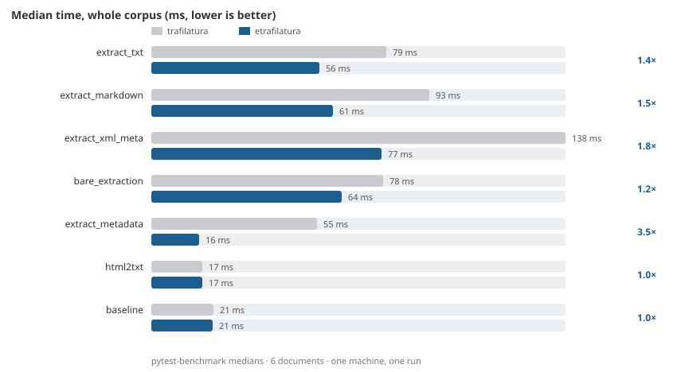

# Benchmark

etrafilatura against [trafilatura](https://pypi.org/project/trafilatura/) 2.3.1 —
pytest-benchmark medians over the fixture corpus (`tests/resources/html/`): two synthetic small pages, an article,
a comments page, a tables page, PEP 8 and a Wikipedia article (121 KB and 236 KB of real HTML).

Generated by `make benchmark` on 2026-10-22 · Linux · cpython · commit 4a77bc30.



## Matrix

Median milliseconds per call, etrafilatura / trafilatura (**speedup**):

| method | minimal | article | comments | tables | real_pep8 | real_wikipedia |
|---|---|---|---|---|---|---|
| `extract_txt` | 0.24 / 0.45 ms (**1.9×**) | 0.74 / 0.65 ms (**0.9×**) | 0.56 / 0.73 ms (**1.3×**) | 0.60 / 0.75 ms (**1.2×**) | 26.52 / 42.42 ms (**1.6×**) | 27.51 / 33.61 ms (**1.2×**) |
| `extract_markdown` | 0.27 / 0.46 ms (**1.7×**) | 0.83 / 0.72 ms (**0.9×**) | 0.65 / 0.79 ms (**1.2×**) | 0.67 / 0.85 ms (**1.3×**) | 29.51 / 55.40 ms (**1.9×**) | 28.83 / 34.68 ms (**1.2×**) |
| `extract_xml_meta` | 0.35 / 0.77 ms (**2.2×**) | 1.07 / 1.58 ms (**1.5×**) | 0.78 / 0.92 ms (**1.2×**) | 0.77 / 1.01 ms (**1.3×**) | 37.77 / 75.57 ms (**2.0×**) | 36.20 / 58.56 ms (**1.6×**) |
| `bare_extraction` | 0.23 / 0.45 ms (**2.0×**) | 0.73 / 0.63 ms (**0.9×**) | 0.57 / 0.75 ms (**1.3×**) | 0.57 / 0.73 ms (**1.3×**) | 26.23 / 41.95 ms (**1.6×**) | 35.32 / 33.00 ms (**0.9×**) |
| `extract_metadata` | 0.03 / 0.21 ms (**6.5×**) | 0.13 / 0.75 ms (**5.7×**) | 0.09 / 0.12 ms (**1.4×**) | 0.07 / 0.16 ms (**2.2×**) | 7.07 / 31.20 ms (**4.4×**) | 8.51 / 22.98 ms (**2.7×**) |
| `html2txt` | 0.02 / 0.02 ms (**1.0×**) | 0.11 / 0.11 ms (**1.0×**) | 0.11 / 0.11 ms (**1.0×**) | 0.09 / 0.09 ms (**1.0×**) | 8.36 / 8.44 ms (**1.0×**) | 8.35 / 8.24 ms (**1.0×**) |
| `baseline` | 0.05 / 0.05 ms (**1.0×**) | 0.14 / 0.20 ms (**1.4×**) | 0.13 / 0.13 ms (**1.0×**) | 0.12 / 0.12 ms (**1.0×**) | 11.10 / 11.49 ms (**1.0×**) | 8.99 / 8.84 ms (**1.0×**) |

## Reproduce

```bash
make benchmark    # uv run --group bench pytest -m bench --benchmark-json=bench.json, then the chart
```

Numbers move with the machine, the Python version and the engine releases; the committed chart is a snapshot,
`make benchmark` regenerates it. Both libraries run in the same process, interleaved by pytest-benchmark,
on the same fixtures.
