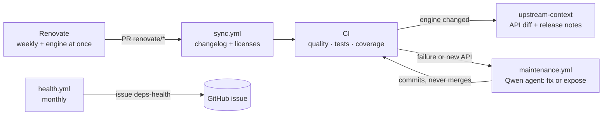

# Self-maintenance

The binding follows its dependencies — above all the engine — without a human in the loop for the routine
cases. Five moving parts, all deterministic except the repair agent, which is gated and allowlisted.

## Renovate

One config (`.github/renovate.json`): the engine (`trafilatura` crate) gets a PR **at once**, one per release,
labelled `upstream-update`; PyO3 gets its own PR (`binding-update`); Python tooling is grouped weekly; GitHub
actions are pinned by digest and bumped monthly. `requires-python` is never touched — it is a support promise.

## sync.yml

On every Renovate PR: records the new engine version in `CHANGELOG.md` (one line, only when the engine
actually changed) and regenerates `THIRD_PARTY_LICENSES.md` from `Cargo.lock`. Deterministic; commits with a
GitHub App token so CI re-runs.

## CI: upstream-context

On engine bumps, CI downloads both crate versions and produces `api-added.txt`, `api-removed.txt`,
`api-diff.txt` and the upstream release notes (`tools/apidiff.sh`, `cargo public-api`). The artifacts feed
the maintenance agent; locally: `make apidiff OLD=0.4.0 NEW=0.5.0`.

## maintenance.yml

After CI on a Renovate branch, a Qwen agent (instructions in `QWEN.md`) runs in one of two modes:

- **fix** — CI failed after the update: repair the binding.
- **expose** — CI passed but the engine's public Rust API gained items: expose them in Python.

Guardrails: it edits files, the workflow commits — through an allowlist (`crates/native/src/`,
`src/etrafilatura/`, `tests/`, `docs/`, changelog, readme); edits outside it are discarded and reported on the
PR. Maximum 3 attempts, then the PR is labelled `needs-human`. It never merges.

## health.yml

Monthly, `tools/health.py` probes every direct dependency (crates.io, PyPI, GitHub): archived repositories,
vanished packages, releases older than 18 months, no push in 12 months. Findings open (or refresh) one issue
labelled `deps-health`; the issue closes itself when everything is healthy again.

## Releases

Tags `v*` trigger `release.yml`: version check, abi3 wheels (Linux x86_64/aarch64, macOS arm64/x86_64,
Windows x86_64), sdist, build-provenance attestations, PyPI publish via trusted publishing. The package
version is set by a human in `pyproject.toml` + `Cargo.toml`; the engine version follows on its own.
