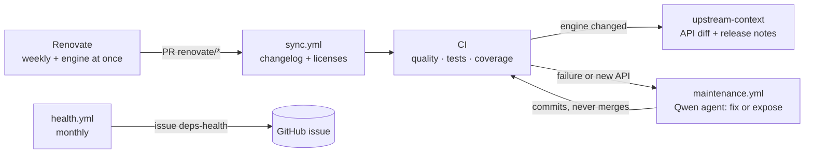

# Self-maintenance

The binding follows its dependencies — above all the engine — without a human in the loop for the routine
cases. Five moving parts, all deterministic except the repair agent, which is gated and allowlisted.

## Renovate

One config (`.github/renovate.json`), weekly unless stated:

| Dependency | PRs | Label |
|---|---|---|
| Engine (`trafilatura` crate) | one per release, **at once** | `upstream-update` |
| `pyo3`, `url` crates | one each | `binding-update` |
| Runtime deps (`project.dependencies`) | one each; range widened, floor never raised | `runtime` |
| Reference Python `trafilatura` (`bench` group) | its own, **at once** — a release moves the fidelity baseline | `reference-update` |
| Dependency groups + build backend (`maturin`) | one grouped PR, `python tooling` | `tooling` |
| Qwen CLI pin (`QWEN_CLI_VERSION` default in `maintenance.yml`) | one per release, regex manager | — |
| GitHub actions | one grouped PR, monthly, pinned by digest | `tooling` |
| `Cargo.lock` + `uv.lock` transitive refresh | lock file maintenance, monthly | — |

`requires-python` is never touched — it is a support promise.

## sync.yml

On every Renovate PR: records the new engine version in `CHANGELOG.md` (one line, only when the engine
actually changed) and regenerates `THIRD_PARTY_LICENSES.md` from `Cargo.lock`. Deterministic; commits with a
GitHub App token so CI re-runs.

## CI: upstream-context

On engine bumps, CI downloads both crate versions and produces `api-added.txt`, `api-removed.txt`,
`api-diff.txt` and the upstream release notes (`tools/apidiff.sh`, `cargo public-api`). The artifacts feed
the maintenance agent; locally: `make apidiff OLD=0.4.0 NEW=0.5.0`.

## maintenance.yml

After CI on a Renovate branch, a Qwen agent (instructions in `QWEN.md`) runs in one of two modes:

- **fix** — CI failed after the update: repair the binding.
- **expose** — CI passed but the engine's public Rust API gained items: expose them in Python.

Guardrails: it edits files, the workflow commits — through an allowlist (`crates/native/src/`,
`src/etrafilatura/`, `tests/` except the `tests/resources/parity/` goldens, `docs/` except the `docs/fidelity.json` baseline, changelog, readme); renames
are checked on both paths. Edits outside it are discarded and reported on the PR. Maximum 3 attempts, then the
PR is labelled `needs-human`. It never merges.

## Configuration

Set at organisation level; the workflows read them, nothing is stored in the repository.

| Name | Kind | Used by | Holds |
|---|---|---|---|
| `APP_CLIENT_ID` | variable | `sync.yml`, `maintenance.yml` | GitHub App client id: commits that re-trigger CI |
| `APP_PRIVATE_KEY` | secret | `sync.yml`, `maintenance.yml` | GitHub App private key |
| `SM_API_KEY` | secret | `maintenance.yml` | API key of the OpenAI-compatible model provider |
| `SM_BASE_URL` | variable | `maintenance.yml` | Base URL of that provider |
| `SM_MODEL` | variable | `maintenance.yml` | Model the agent runs on |
| `QWEN_CLI_VERSION` | variable, optional | `maintenance.yml` | Version of the Qwen Code CLI (the agent, not the provider); defaults to the pin Renovate bumps |

## health.yml

Monthly, `tools/health.py` probes every direct dependency (crates.io, PyPI, GitHub): archived repositories,
vanished packages, releases older than 18 months, no push in 12 months. Findings open (or refresh) one issue
labelled `deps-health`; the issue closes itself when everything is healthy again.

## Releases

Tags `v*` trigger `release.yml`: version check, abi3 wheels (Linux x86_64/aarch64, macOS arm64/x86_64,
Windows x86_64), sdist, build-provenance attestations, PyPI publish via trusted publishing. The package
version is set by a human in `Cargo.toml` (`[workspace.package]`) — `pyproject.toml` declares it dynamic and
maturin reads it from there; the engine version follows on its own.
