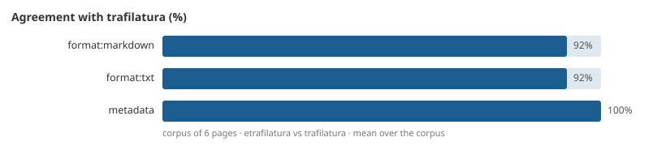

# Output formats

`extract(..., output_format=...)` renders the same extraction in seven formats, with trafilatura's own renderers.

```pycon
>>> import etrafilatura as trafilatura
>>> html = """<html><head><title>Small tools win</title></head><body><article><h1>Small tools win</h1>
... <p>A tool that does one job is cheap to audit, cheap to replace, and composes with the rest through plain text.</p>
... <p>Platforms accumulate switching costs until leaving them costs more than staying; small tools never do.</p>
... <blockquote>Write programs that do one thing and do it well.</blockquote>
... <ul><li>grep searches</li><li>sort orders</li></ul></article></body></html>"""
>>> print(trafilatura.extract(html, output_format="xml"))  # doctest: +ELLIPSIS
<doc fingerprint="...">
  <main>
    <head rend="h1">Small tools win</head>
    <p>A tool that does one job is cheap to audit, cheap to replace, and composes with the rest through plain text.</p>
    <p>Platforms accumulate switching costs until leaving them costs more than staying; small tools never do.</p>
    <quote>Write programs that do one thing and do it well.</quote>
    <list rend="ul">
      <item>grep searches</item>
      <item>sort orders</item>
    </list>
  </main>
  <comments/>
</doc>
>>> print(trafilatura.extract(html, output_format="html"))
<html>
  <body>
    <h1>Small tools win</h1>
    <p>A tool that does one job is cheap to audit, cheap to replace, and composes with the rest through plain text.</p>
    <p>Platforms accumulate switching costs until leaving them costs more than staying; small tools never do.</p>
    <blockquote>Write programs that do one thing and do it well.</blockquote>
    <ul>
      <li>grep searches</li>
      <li>sort orders</li>
    </ul>
  </body>
</html>
>>> import json
>>> sorted(json.loads(trafilatura.extract(html, output_format="json")))
['comments', 'text']

```

| Format | Returns | Notes |
|---|---|---|
| `txt` *(default)* | Main text, then comments | `with_metadata=True` prepends a YAML header |
| `markdown` | Main text as Markdown | Formatting implied |
| `xml` | `<doc>`: metadata attributes, `<main>`, `<comments>` | trafilatura's vocabulary: `head`, `quote`, `list`/`item`, `table`/`row`/`cell`, `hi`, `ref` |
| `xmltei` | A TEI document | `tei_validation=True` validates against trafilatura's `tei_corpus.dtd` |
| `json` | `text`, `comments` and, with metadata, every `Document` field | `ensure_ascii=False` |
| `csv` | One tab-separated row: url, id, fingerprint, hostname, title, image, date, text, comments, license, pagetype | |
| `html` | A self-contained HTML document | `<meta>` head with `with_metadata=True` |

The renderers are trafilatura's code, vendored verbatim; what can still differ is the content the engine selects
→ [Compatibility](compatibility.md).

## Fidelity

`make fidelity` runs the fixture corpus (`tests/resources/html/`: six synthetic pages, PEP 8 and a Wikipedia
article) through etrafilatura and Python trafilatura and scores, per page:

| Metric | Measures |
|---|---|
| `exact:<format>` | Share of pages whose output is byte-identical, for each of the seven formats |
| `format:txt`, `format:markdown` | Word-token similarity; blind to whitespace and markup; a `None` on one side only scores 0 |
| `metadata` | Share of equal fields among title, author, date, sitename, url, hostname, categories, tags, pagetype |



The mean over the corpus is committed in [`fidelity.json`](fidelity.json); a drop beyond the tolerance fails the
check, and `make fidelity ARGS=--update` rewrites it. The six synthetic pages are identical in every format except
where [Compatibility](compatibility.md#divergences) says otherwise; the two real pages differ by the engine's content
selection.
